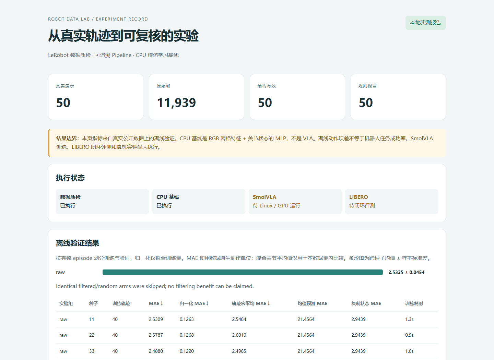

# Robot Data Lab

面向具身智能数据工程的作品集项目：**公开真实机器人数据 → 质量审计 → 轨迹筛选 → CPU 模仿学习训练 → 离线评测 → 可交互报告**。

工程状态和结果以 [`reports/index.html`](reports/index.html)、[`reports/experiments.json`](reports/experiments.json) 为准。

用于求职展示时，可参考[简历描述、验证证据和面试演示说明](docs/portfolio.md)。



本次实测：50 条轨迹全部通过当前规则；40 条训练、10 条验证；抽样得到 3,995 个训练/验证帧样本。三个训练种子的离线 MAE 为 **2.5325 ± 0.0454**（数据原生单位），复制状态对照为 **2.9439**。这是离线回归结果，不能解释为抓取成功率。
14 项单元测试通过，阶段缓存复用、安装和报告交互均已检查；详细范围见 [`reports/validation.json`](reports/validation.json)。
CI 配方保存在 [`ci/github-actions.yml`](ci/github-actions.yml)，本次没有启用远程 Actions。当前 GitHub 授权没有 `workflow` 权限，因此先提供模板；日后可通过 GitHub 网页将其放入 `.github/workflows/tests.yml` 启用自动测试。

| 模块 | 当前范围 |
| --- | --- |
| 真实数据 | 下载并校验公开 SO 系列抓取演示；不是自行采集 |
| 数据质量 | 结构、数值、时间顺序、动作/状态维度、任务标注关联、抽样视频解码检查 |
| 自动化 | 不可变数据版本、SHA-256 校验、阶段缓存、失败记录、确定性轨迹划分 |
| 本地训练 | 双相机 RGB 网格 + 关节状态 MLP 行为克隆；不是 ACT 或 VLA |
| 本地评测 | 按完整轨迹留出的离线动作误差、多种子实验、均值预测及复制状态对照 |
| SmolVLA / LIBERO | 固定上游代码和数据版本的 Linux/GPU 运行入口；本机未执行 |
| 算法结论 | 仅报告实际测得的数据；不声称真机成功率或论文指标复现 |

## 本地启动（Windows / Python 3.10）

```powershell
./scripts/setup-local.ps1
./scripts/run-local.ps1
./scripts/serve.ps1
```

打开 http://127.0.0.1:8765 查看本地报告，也可以直接打开 `reports/index.html`。
当前受限执行环境无法跨沙箱访问 loopback 端口，因此 HTML 已直接渲染验证；没有宣称后台 HTTP 服务已在用户浏览器中验证。可在普通 PowerShell 中运行 `serve.ps1`，或直接打开 HTML。
首次下载约 86 MB 公开数据，具体字节数见 source manifest。代码、原始数据和模型权重分开管理。
当前部署的 venv 使用本机已有 CPU PyTorch 等依赖（system-site-packages）；`setup-local.ps1` 在新机器创建独立环境。

```powershell
.venv/Scripts/python.exe -m robot_data_lab doctor
.venv/Scripts/python.exe -m robot_data_lab download
.venv/Scripts/python.exe -m robot_data_lab audit
.venv/Scripts/python.exe -m robot_data_lab annotations export
.venv/Scripts/python.exe -m robot_data_lab annotations validate
.venv/Scripts/python.exe -m robot_data_lab run-local --offline
.venv/Scripts/python.exe -m unittest discover -s tests -v
```

已有数据可 `--offline` 执行，运行前仍会验证全部文件 SHA-256。`--force` 重跑计算阶段。修改 `configs/local.json` 后缓存自动失效。
标注导出生成可人工编辑的 JSONL，保留原始数据。每条标签有来源、复核状态和备注；schema 校验不会被当作语义正确率。导出不覆盖已有人工编辑。此 sidecar 用于组织和复核，标签更正尚未回写 LeRobot 数据，也不自动用于本地无语言基线训练。
所有命令在项目根目录运行。原始文件不会被筛选过程改写；筛选结果保存为 episode ID 清单。

## 数据与检查方法

- 数据：[lerobot/svla_so101_pickplace](https://huggingface.co/datasets/lerobot/svla_so101_pickplace)，固定版本 `f641879e22172be7e8161d5e6c1503c2d2feb657`。
- 实际 `meta/info.json` 为 LeRobot v3.0，50 条演示，11,939 帧，两个相机；数据卡里的旧 v2.1 示例不作为解析依据。
- `meta/tasks.parquet` 是任务标签来源；检查每个 `task_index` 都能找到标注。本项目没有将 VLM 自动生成文本宣称为人工真值。
- 数值检查：NaN/Inf、特征维度、帧序连续性、时间单调性、轨迹长度、全局索引与元数据一致性。
- 视频检查：通过每条轨迹的 `from_timestamp` 定位分片中的相机帧，真实解码；不能用文件存在代替可解码性。
- `state_jump`、`long_idle`、`short_episode` 是可配置的筛选规则；模糊/低纹理仅警告。
- 阈值为数据原生单位，无通用机器人含义；停顿可能是有效任务阶段。视频抽检不证明全帧无损或真实传感器完全同步。

## 训练与实验协议

按 episode 进行固定 80/20 划分，绝不随机拆散相邻帧。均值、标准差仅从当前实验组训练集拟合。
图像特征是每个相机 8×8 RGB 网格，拼接 6 维关节状态；两层 MLP 回归演示动作。这是低成本管线基线，没有语言编码器，不能代表 VLA 性能。

1. `raw`：全部结构有效的训练轨迹。
2. `filtered`：训练集中通过预设质量规则的轨迹。
3. `random_matched`：从原始训练集随机抽取同等数量的轨迹。

各组使用相同验证轨迹、更新步数和 batch size；训练种子默认 11、22、33。
如果规则没有剔除训练轨迹，跳过后两组重复训练，明确报告“无法据此声称过滤收益”。若过滤后为空则报错，不悄悄退回原数据。
轨迹数匹配不等于帧数匹配，报告中同时记录样本数。验证集只做评估，不用它挑选过滤阈值；后续调参应另留测试集。

指标包括逐关节 MAE、帧平均 MAE、按轨迹宏平均 MAE、归一化 MAE、多种子标准差。关节单位可能不同，跨机器人不能比较混合平均 MAE。
绝对位置动作很容易被“复制当前状态”预测；因此同时报告这个强对照。离线误差低不保证闭环成功。

## Linux/GPU 上运行 SmolVLA

此部分是**待执行的集成入口**，不是已验证的训练结果。需要自行提供 Linux、Python 3.12、CUDA GPU 和算力；脚本不创建付费云资源。
LeRobot v0.6.1 源码要求 Python >=3.12；本机 Python 3.10 / torch 2.1 CPU 环境与其隔离。

```bash
bash scripts/setup-cloud.sh
source .venv-cloud/bin/activate
python -m robot_data_lab cloud plan --steps 20000 --batch-size 4
# 先用 100 步验证环境与显存，再启动正式训练。
python -m robot_data_lab cloud train --steps 100 --batch-size 1
python -m robot_data_lab cloud train --steps 20000 --batch-size 4
python -m robot_data_lab cloud eval \
  --checkpoint runs/smolvla-libero-s42-steps20000/checkpoints/last/pretrained_model \
  --episodes 10 --seed 42
```

该配方遵循官方 LIBERO 的 SmolVLA 初始化路径：加载固定版本的预训练 VLM、训练动作专家；不是从已训练机器人策略继续微调的效果声明。
训练使用 `lerobot/libero` 的完整固定版本，初始闭环评测限定 LIBERO-Spatial。需要按实验目的扩展其它 suites，并保持评测协议一致。
20k 步、小 batch 是起步配置，不保证收敛或复现论文数值。`requirements-cloud.txt` 固定关键依赖和 LeRobot commit；其完整依赖解析、GPU 安装和运行仍需在目标 Linux 主机验证，安装脚本保存 resolved freeze。
运行时检查 LeRobot 的安装来源 commit，下载固定 SHA 的 VLM 权重。所有命令与完成/失败状态保存于 `runs/`。
如需续训，使用上游保存的 `train_config.json` 和 `lerobot-train --resume=true --config_path=...`；不要覆盖已有输出目录。

## 目录

```text
configs/             数据、阈值、训练和云端版本配置
robot_data_lab/      下载、v3 读取、审计、特征、训练、报告与 CLI
scripts/             Windows 本地与 Linux GPU 环境入口
tests/               数据损坏、时间顺序、划分泄漏、训练确定性、视频对齐测试
reports/             可分享的实际质量报告、实验结果与溯源信息
data/                原始数据，Git 忽略
artifacts/           模型、特征、分组、阶段缓存，Git 忽略
runs/                GPU 训练、评测日志与 checkpoint，Git 忽略
```

## 致谢与许可

独立工程项目，基于 [Hugging Face LeRobot](https://github.com/huggingface/lerobot) 的数据格式和官方训练入口。
新编写代码采用 MIT；原始数据与上游 LeRobot 分别遵守其 Apache-2.0 等原始许可。没有将上游代码拷贝后宣称为个人算法实现。
参考：[数据工具](https://huggingface.co/docs/lerobot/using_dataset_tools)、[SmolVLA](https://huggingface.co/docs/lerobot/smolvla)、[LIBERO](https://huggingface.co/docs/lerobot/libero)。
